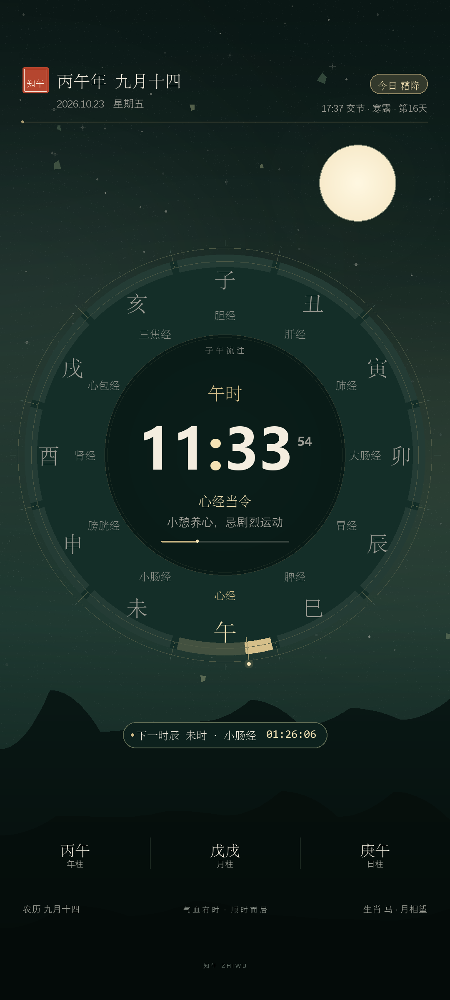

# 子午流注时钟 · 知午

> GitHub：**[xioceng/ziwu-clock](https://github.com/xioceng/ziwu-clock)**  
> GitHub 仓库地址只支持 ASCII 字符，所以 slug 使用 `ziwu-clock`；仓库标题、描述和界面均使用中文「子午流注时钟」。
>
> [GitHub Releases](https://github.com/xioceng/ziwu-clock/releases) · [下载 v1.1.0 APK](https://github.com/xioceng/ziwu-clock/releases/download/v1.1.0/ziwu-1.1.0.apk)

一款为 Android 手机打造的中文动态壁纸：把**万年历、二十四节气和十二时辰经络流注**放进同一枚会呼吸的表盘。全部画面由 Canvas 实时绘制，随时辰换色，星尘、流云与四时花木缓慢流动。(ai编写的程序，可能有些要求不完善)



> 预览图按壁纸渲染参数生成，实际显示会因屏幕比例、系统字体和启动器而略有差异。

## 功能

- **十二时辰表盘**：子、丑、寅……亥十二等分，标注当令经络；当前时辰金色高亮，并显示时辰进度。表盘占屏幕宽度约 89%，外圈节气刻度贴近左右边框。
- **大字号长辈模式**：主时间加粗放大，干支、经络、养生提示、下一时辰、三柱与农历脚注整体加大；表盘底环加深、顶部/底部增加渐变遮罩，深色背景下文字对比更明显。
- **子午流注**：午时心经、子时胆经等十二经络当令提示，附一句简短的养生短语。
- **万年历**：农历月日（含闰月）、年/月/日干支、生肖、星期、公历日期。
- **二十四节气**：显示当前节气、第几天，以及下一节气倒计时；交节当天精确到分钟，例如「今日霜降 17:37 交节」。
- **下一时辰**：显示下一时辰、对应经络和精确倒计时。
- **会自动换色**：默认「自动」配色随十二时辰从墨夜、破晓、青瓷、正午、暮色流转。
- **五种配色**：自动、墨夜、青瓷、朱砂、素笺（浅色）。
- **动态细节**：星尘闪烁、月相/太阳、流云山影、春花瓣/夏萤火/秋落叶/冬雪，以及启动器滑动视差。
- **显示选项**：秒数、动态效果、经络提示均可关闭。
- **完全本地**：不需要网络，不申请 INTERNET 权限，不收集数据。

## v1.1.0 的可读性调整

- 圆盘直径由屏幕宽度的约 81% 放大到约 89%，外圈节气刻度更靠近左右边框。
- 主时间改为加粗字体并放大；十二地支、经络名、干支、农历、下一时辰与三柱文字同步放大。
- 经络标签按圆盘尺寸自适应，缩小预览卡里也不会压住内圈。
- 圆盘增加半透明深色底环，顶部和底部增加渐变遮罩，弱化星尘/山影对文字的干扰。

## 安装

APK：`dist/zhiwu-1.1.0.apk`（SHA-256：`05F4C07788A884523A923670EDAA91866AC0725CE2962D705E68D0B87C8F3451`）

1. 把 APK 传到手机（数据线、微信文件传输、网盘均可），点击安装。
2. 如果系统提示「未知来源」，允许当前文件管理器安装。
3. 打开「知午 · 子午流注」，点击 **设为动态壁纸**。
4. 在系统壁纸预览页确认「知午 · 十二时辰」，选择设为桌面或桌面与锁屏。

如果按钮没有直接打开预览，可长按桌面空白处 → **壁纸** → **动态壁纸** → **知午 · 十二时辰**。

- 支持 Android 6.0（API 23）及以上。
- 部分国产系统的锁屏壁纸需要单独在「设置 → 壁纸/锁屏」里选择；是否支持桌面+锁屏同时设置取决于系统。
- 更换静态壁纸前无需卸载；如果桌面短暂黑屏，重新选择一次壁纸即可。

## 使用

- 预览卡：轻触可循环切换五种配色。
- **外观**：选择自动或四种固定配色。
- **显示**：秒数、动态效果、经络提示。
- 表盘自动刷新：有时钟秒数时每秒更新；关闭动态效果后仍会低频刷新时间。
- 壁纸会随启动器左右滑动产生轻微视差。

## 历法与口径

- 农历、干支、生肖、节气交接时刻由 [lunar-java 1.7.7](https://github.com/6tail/lunar-java) 本地计算，MIT 许可。
- 年柱、月柱采用**立春/节气换柱**；日柱按**公历日 00:00 换日**显示（因此 23:00–24:00 的日柱仍属于当天，未做「子初换日」）。
- 节气交接时刻按**北京时间（UTC+8）**计算和显示；海外时区使用时，节气日期可能与本机日期相差一天，请留意。
- 十二时辰经络采用中医养生中常用的**十二经纳子法**（每个时辰对应一条经络），不是子午流注纳甲法的按时开穴。养生短语仅作传统文化展示，不构成医疗建议。
- 月相按农历日近似绘制；节气当天全天显示「今日交节」，但表盘中央的当前节气会在交节时刻之后切换。

## 构建

项目不依赖 Gradle，使用 Android SDK 命令行工具直接构建；这样在没有 Android Studio 的机器上也能产出签名 APK。

```bash
git clone https://github.com/xioceng/ziwu-clock.git
cd ziwu-clock
```

需要：

- JDK 17
- Android SDK Platform 35 的 `android.jar`
- Android Build-Tools（含 `aapt2`、`d8`、`zipalign`、`apksigner`）

本项目工作区里已放了所需工具，脚本会自动向上级目录查找：

```powershell
# Windows PowerShell
powershell -ExecutionPolicy Bypass -File .\build.ps1
```

也可以显式指定：

```powershell
.\build.ps1 -Jdk "C:\path\to\jdk-17" -Sdk "C:\path\to\platforms\android-35" -BuildTools "C:\path\to\build-tools\35.0.0"
```

构建产物：`dist/zhiwu-<version>.apk`。

> 构建脚本会先把工程复制到 `%TEMP%\zhiwu-build`，因为 AAPT2 在 Windows 上对含中文的工程路径支持不稳定。

## 目录

```
zhiwu-wallpaper/
├─ app/src/main/
│  ├─ AndroidManifest.xml
│  ├─ java/com/zhiwu/wallpaper/
│  │  ├─ MainActivity.java           设置与预览页
│  │  ├─ MeridianWallpaperService.java  动态壁纸服务与渲染线程
│  │  ├─ WallpaperRenderer.java     全部 Canvas 绘制
│  │  ├─ CalendarData.java          农历/节气/干支快照
│  │  ├─ Shichen.java               十二时辰与经络数据
│  │  ├─ Palette.java               自动/固定配色
│  │  ├─ Settings.java              偏好设置
│  │  ├─ ThemeSwatchView.java       配色选择控件
│  │  └─ WallpaperPreviewView.java  应用内实时预览
│  └─ res/                          字符串、图标、壁纸缩略图、样式
├─ lib/lunar-1.7.7.jar              MIT 历法库
├─ screenshots/preview.png           设计预览
├─ build.ps1                         无 Gradle 构建脚本
└─ dist/zhiwu-1.1.0.apk              已签名安装包
```

## 签名

仓库**不包含**发布签名密钥；`keystore/`、`*.jks`、`*.keystore` 已加入 `.gitignore`。

- local build 首次运行 `build.ps1` 会自动生成一个仅供本地测试的密钥；正式发布请用 `-Keystore <path> -StorePass <password>` 指定离线保管的发布密钥。
- `dist/zhiwu-1.1.0.apk` 是维护者用私有发布密钥签名的安装包。公开仓库不会提供该密钥，避免他人伪造更新。
- 如果你要长期维护自己的版本，请自己生成并离线备份密钥；一旦丢失，后续 APK 无法覆盖安装旧版本。

## 隐私

- 不申请网络权限。
- 不读取通讯录、位置、存储等敏感权限。
- 只使用 `SET_WALLPAPER` 用于打开系统壁纸设置页；所有历法计算在本地完成。

## 许可

- 应用代码：MIT，见 `LICENSE`。
- 历法库：lunar-java，MIT，见 `THIRD_PARTY_NOTICES.md`。
- 字体使用 Android 系统自带的 Noto Serif / Noto Sans CJK 回退，不随 APK 分发字体文件。

## 已知限制

- 不是可交互的桌面小组件；点击壁纸不会打开应用，请从桌面图标进入设置。
- 部分启动器会强制裁切或缩放动态壁纸，表盘位置可能变化。
- 浅色「素笺」主题在浅色图标/白色图标字体的桌面下可读性较弱，建议搭配深色图标包。
- 未在真机上做逐机型适配；如遇渲染异常，请提供机型、Android 版本和截图。
